# Marching Cubes 33 · Dynamic LODs

Turn a grid of numbers into a triangle mesh, or fly through terrain that adds detail as you get closer. **Planet Approach** opens by default.

[Live demo](https://marchingcubeswebgpu.netlify.app/) · [Package guide](docs/PACKAGE.md) · [Noise Compute upstream](https://github.com/joshbrew/webgpu_noise_compute_textures)

**Contents** · [Quick start](#quick-start) · [Gallery](#gallery) · [Demos and settings](#demos-and-settings) · [Terrain noise](#terrain-noise) · [How it works](#how-it-works) · [Use in your project](#use-in-your-project) · [Benchmarks](#benchmarks)

## Quick start

With Node.js 20 or newer, open the repo folder and run:

```sh
npm install
npm start
```

Open the address printed by the server. Use the tabs to switch demos. The sphere has a CPU mode. GPU extraction and the worlds need WebGPU in a browser, served locally or over HTTPS.

## Gallery

[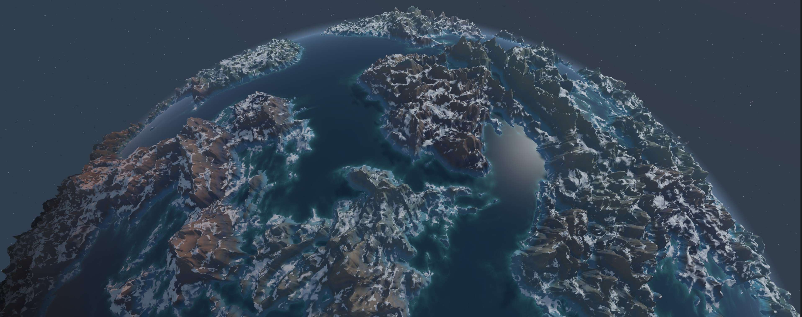](docs/gallery/alpine-coast.jpg)

| Ocean world | Desert world | Mountain valley |
| --- | --- | --- |
| [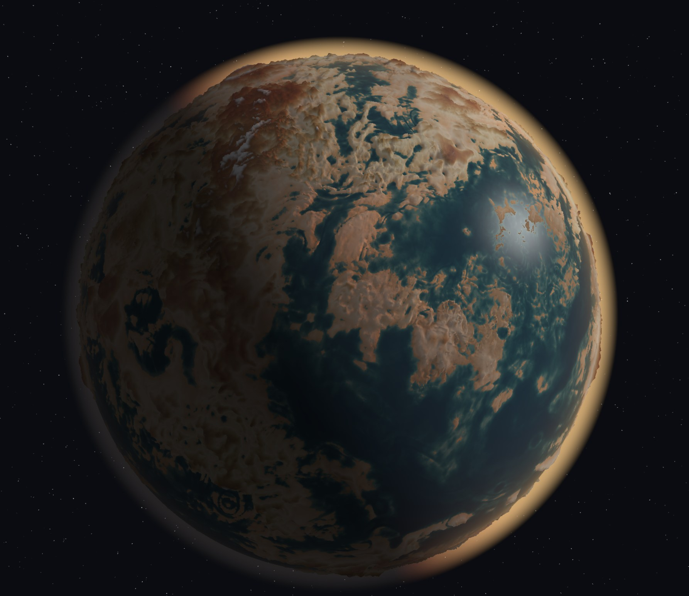](docs/gallery/ocean-world.jpg) | [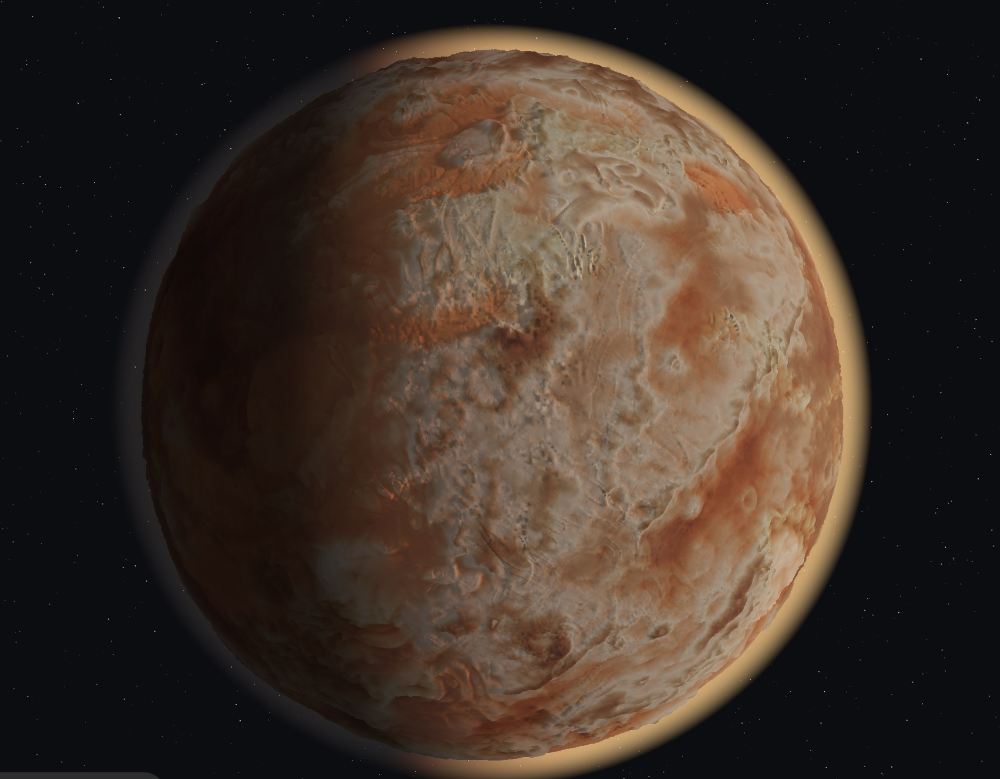](docs/gallery/desert-world.jpg) | [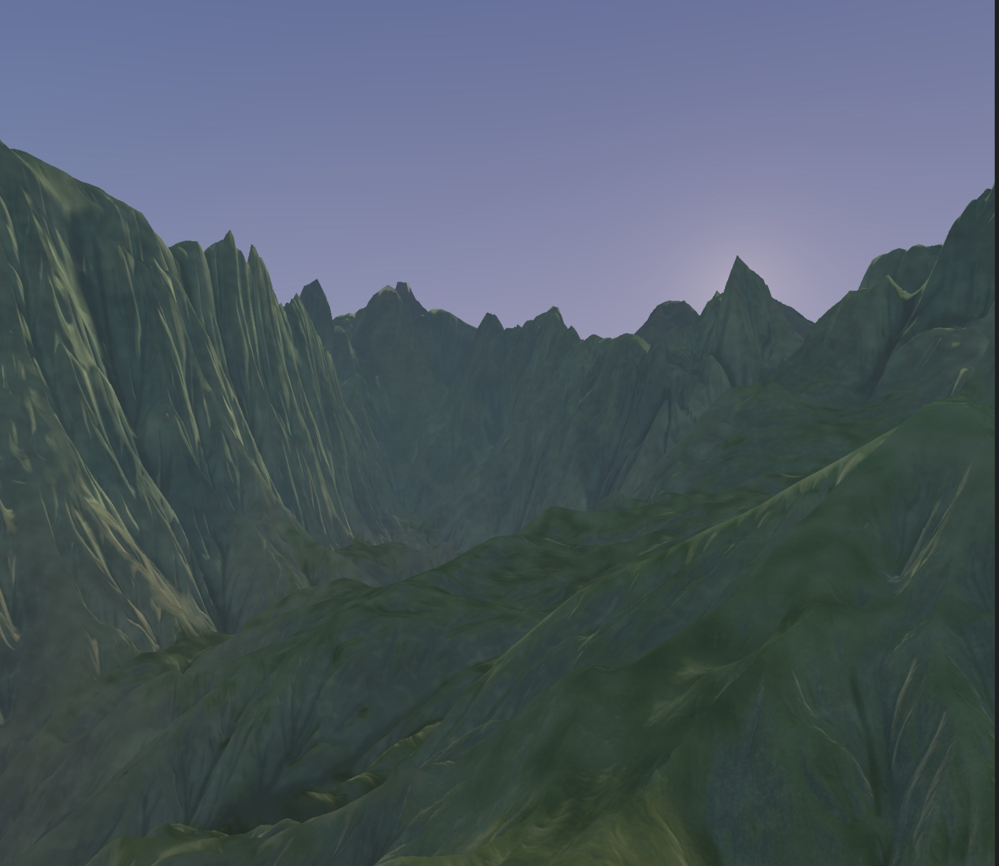](docs/gallery/mountain-valley.jpg) |

| Rocky limb | Eroded ranges |
| --- | --- |
| [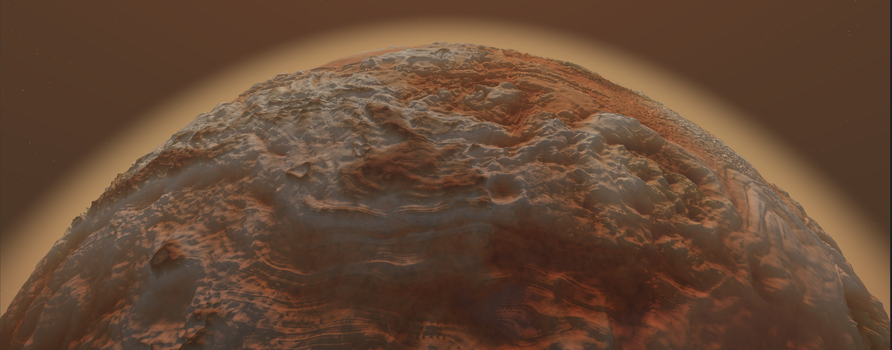](docs/gallery/rocky-limb.jpg) | [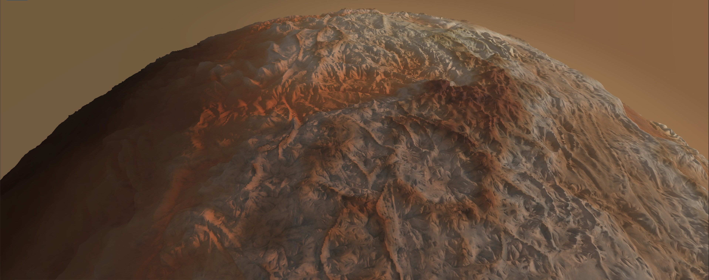](docs/gallery/eroded-ranges.jpg) |
| [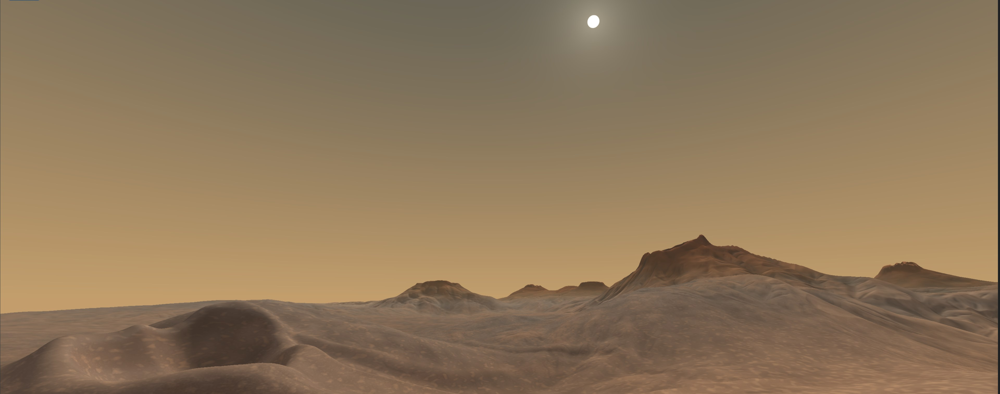](docs/gallery/desert-surface.jpg) | [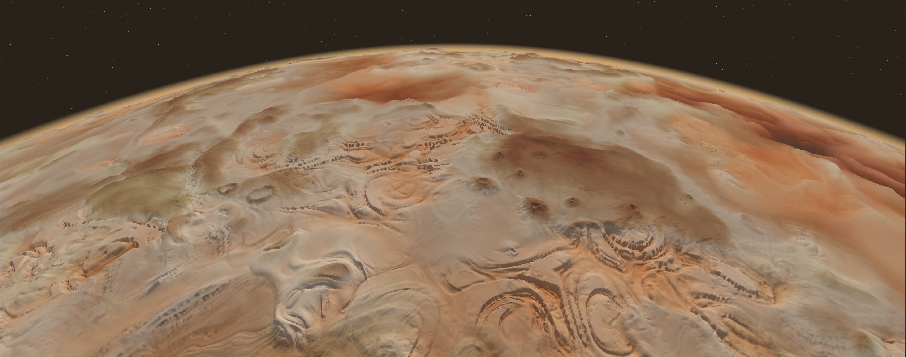](docs/gallery/cratered-badlands.jpg) |


## Demos and settings

| Demo | What to try |
| --- | --- |
| [Planet Approach](https://marchingcubeswebgpu.netlify.app/?demo=planet) | Choose a **preset**, **world size**, or **Explore region**, then **Start approach** from 300 km or jump to **Near surface**. **Terrain sampling** switches between procedural vertices and a cached atlas on the same seed. **Day and night** controls the sun angle, animation and atmosphere. |
| [Sphere](https://marchingcubeswebgpu.netlify.app/?demo=sphere) | Switch **Bourke / MC33**, **CPU / WebGPU**, and Cartesian, spherical or cube-sphere sampling. Pick the inner, outer or both shells. **Shell thickness** sets their separation. A **Surface offset** of 0 matches the source points’ outer radius. |
| [Terrain](https://marchingcubeswebgpu.netlify.app/?demo=terrain) | Toggle adaptive or uniform sampling, change pixel error, player detail radius, field of view and render distance. **Instanced trees** have their own distance control. Enable **Infinite terrain** for an endless flythrough. |
| [Infinite Space](https://marchingcubeswebgpu.netlify.app/?demo=space) | Fly among asteroids, floating islands and ringed planets. Select meshes, points or both. Adjust render distance, mesh detail, LOD distance, near-detail radius, farthest mesh grade and point size. |
| [Noise Tiles](https://marchingcubeswebgpu.netlify.app/?demo=progressive) | Click **Near the ground** or use **Height**. **Tile detail** and **Render distance** control how finely the surface is sampled and how far it extends. |

Fly with **WASD**, **Space** up, **C** down, and **Shift** to go faster. Drag to look. In Planet Approach, left drag orbits, right drag looks around, and **H** hides the UI. **LOD colors** and **Wireframe** show where the mesh gets finer.

Choose **Ceres Crater Fields** for overlapping impacts from orbit down to the surface, or **Pluto** for ice canyons with narrow tributaries.

Planet **Mesh detail** defaults to **1.25 px**, **4× distant LOD**, and **800,000 triangles**. Lower pixel error keeps smaller features. Higher distant LOD keeps detail farther out. The triangle budget caps patch count and vertex-cache size. For stress testing, use **1 px**, **32×**, and up to **about 16 million grid vertices** (roughly 28.3 million triangles), subject to GPU and sampling-mode limits. The performance panel shows the grid vertices and triangles in the current view.

## Terrain noise

Open **Terrain noise** in Planet Approach. The package accepts the same choices in `createPlanet(canvas, { detail })` and `planet.configure({ detail })`.

Open **Terrain layers and region map** to choose the noise and uniforms for each of the five base layers. The region map uses the planet seed, an algorithm, a frequency, and a blend width. Each layer has a 0–1 weight for mountains, canyons, granite, and volcanic terrain. Blank uniforms inherit the preset values. In code, pass this recipe as `detail.noiseMix`, or pass `null` to restore the preset mix.

| Control | Input | What it changes |
| --- | --- | --- |
| Landscape | `landscape` | `natural`, `mesas`, `fractal` or `mosaic`. Choose the broad landforms. |
| Style strength | `landscapeStrength` (0–1) | Blend the selected style into the natural terrain. |
| Relief multiplier | `relief` (0.25–1.25) | Scale terrain heights and sea level. |
| Mountain ranges | `range` | `hybrid`, `ridges` or `rolling`. Change the shape of the large ranges. |
| Hillside detail / Ground detail | `slopes` / `ground` | `erosion`, `incised` or `soft` at two different scales. |
| Hillside / Ground octaves | `slopeOctaves` (0–4), `groundOctaves` (0–5) | Add layers at progressively smaller scales. |
| Local erosion | `erosionStrength` (0–2) | Change how strongly the local drainage cuts into the surface. |
| Regional variation | `variation` (0–1) | Vary how terrain styles blend across a single planet. |

Use a fixed `studioSeed` to reproduce a planet. To build your own GPU textures or volumes, use `NoiseComputeBuilder`. Pick kernels with `noiseChoices` and pass values such as `seed`, `zoom`, `freq`, `octaves`, `lacunarity` and `gain`. `scalar` and `transform` adjust a layer’s contribution. See the [noise API and examples](docs/PACKAGE.md#generate-noise) and [upstream Noise Compute settings](https://github.com/joshbrew/webgpu_noise_compute_textures).

## How it works

- **Marching cubes** connects places where a field crosses a chosen value. Bourke uses the classic lookup table. MC33 also tests ambiguous faces and interiors to choose how the surface connects.
- **Level of detail (LOD)** spends triangles where you can see them. Flat terrain and Noise Tiles stitch neighboring patches at different resolutions. Infinite Space streams seeded 3D sectors and switches each body’s mesh or point density with distance.
- **Planet Approach** uses stitched cube-sphere patches. Seeded fBm, ridged multifractal, Voronoi and billow shape broad relief. Erosion and landform passes add drainage and regional features. Procedural mode samples the terrain at patch vertices with a compact erosion guide. Cached mode samples the baked atlas.

[Extraction API](docs/API.md) · [Terrain and trees](docs/TERRAIN.md) · [Space](docs/SPACE.md) · [Progressive tiles](docs/PROGRESSIVE.md)

## Use in your project

From this repo, build the library and run the CPU sphere example:

```sh
npm run build:library
node examples/sphere.js
```

```js
import { Coordinates, extractCPU } from "marching-cubes-bourke-mc33/core";

const size = { x: 32, y: 32, z: 32 };
const field = Coordinates.sampleField(size, (x, y, z) =>
  Math.hypot(x - 0.5, y - 0.5, z - 0.5) - 0.3
);
const positions = extractCPU(field, size, 0, "mc33");
console.log(positions.length / 9, "triangles");
```

Use `npm pack` and install the resulting tarball in your project. The [package guide](docs/PACKAGE.md) has ESM, Node CommonJS and plain browser imports, plus working examples for canvases, cameras, world settings and noise. For deployment, `npm run build` writes the static site to `site/`. Run `npm test` for the automated checks.

## Benchmarks

<details>
<summary>Current demo captures and how to repeat them</summary>

| Sphere extraction | Adaptive terrain and trees |
| --- | --- |
| [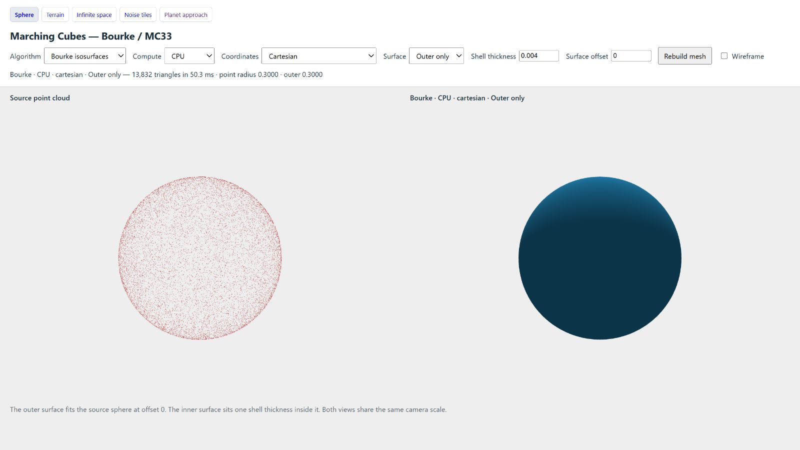](docs/benchmarks/sphere-demo.jpg) | [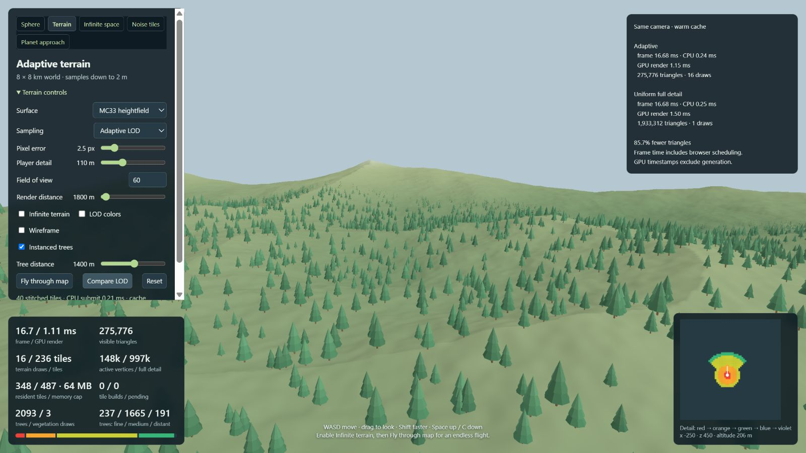](docs/benchmarks/terrain-tinybuild-benchmark.jpg) |
| **13,832 triangles** with Bourke on CPU. Click **Rebuild mesh** to repeat. | **275,776 vs. 1,933,312 terrain triangles** with trees enabled. Click **Compare LOD** to repeat at the same camera. |

| Infinite Space | Noise Tiles |
| --- | --- |
| [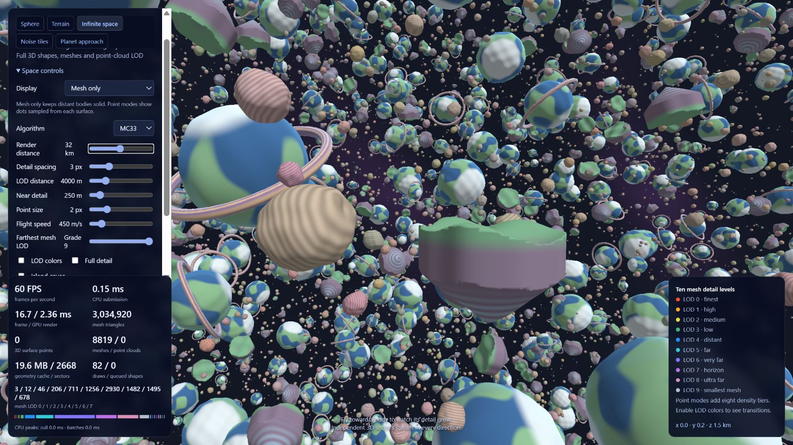](docs/benchmarks/space-tinybuild-32km.jpg) | [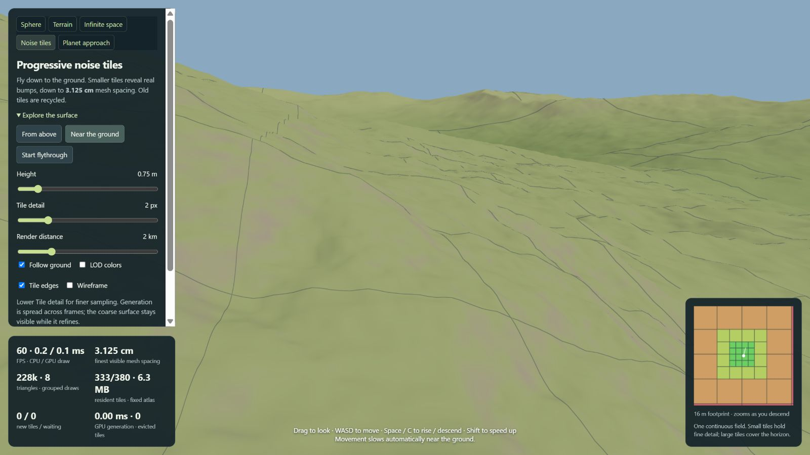](docs/benchmarks/progressive-noise-tiles.jpg) |
| **3,034,920 triangles** across 8,819 bodies. Set **Render distance** to 32 km in mesh mode. | **3.125 cm** finest spacing in a fixed **6.3 MB** atlas. Click **Near the ground** to repeat. |

These captures show individual runs. Timings vary by GPU, browser and viewport. See the [terrain](docs/TERRAIN.md#checks), [space](docs/SPACE.md#budgets-and-measurements) and [Noise Tiles](docs/PROGRESSIVE.md) docs for repeatable checks.

</details>

[MIT License](LICENSE) · [Source credits](THIRD_PARTY_NOTICES.md)
