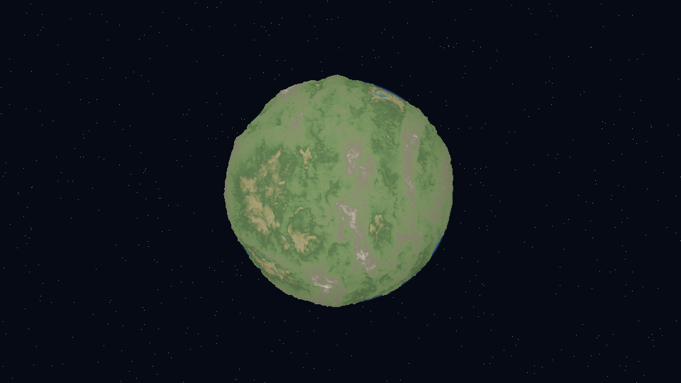
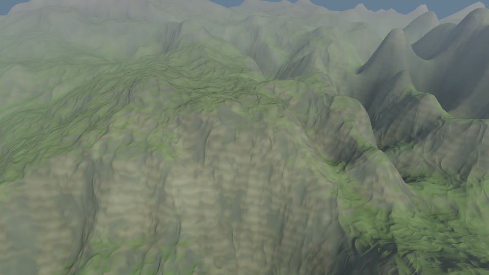
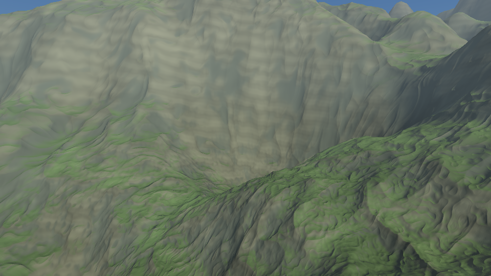
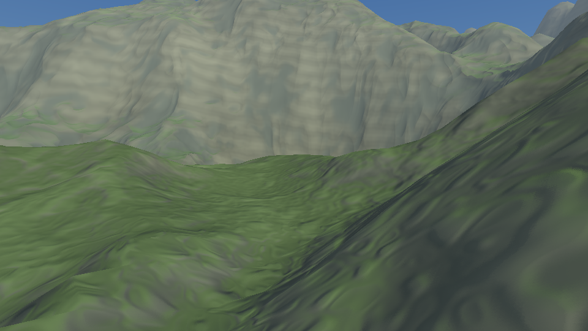
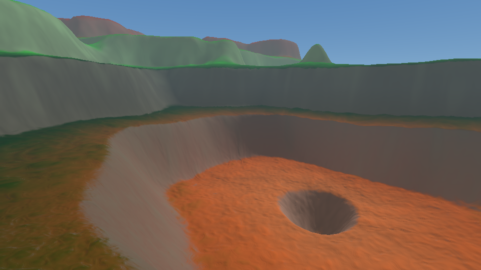
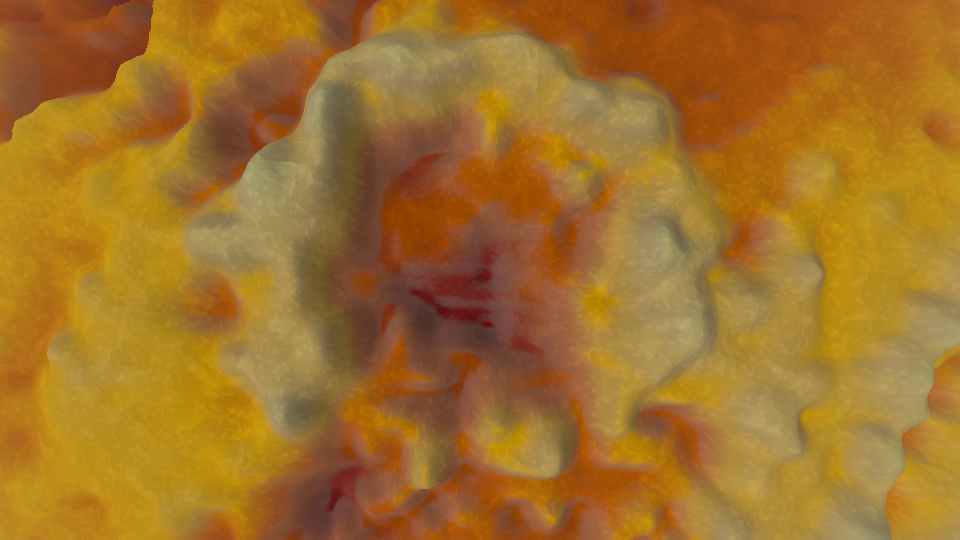
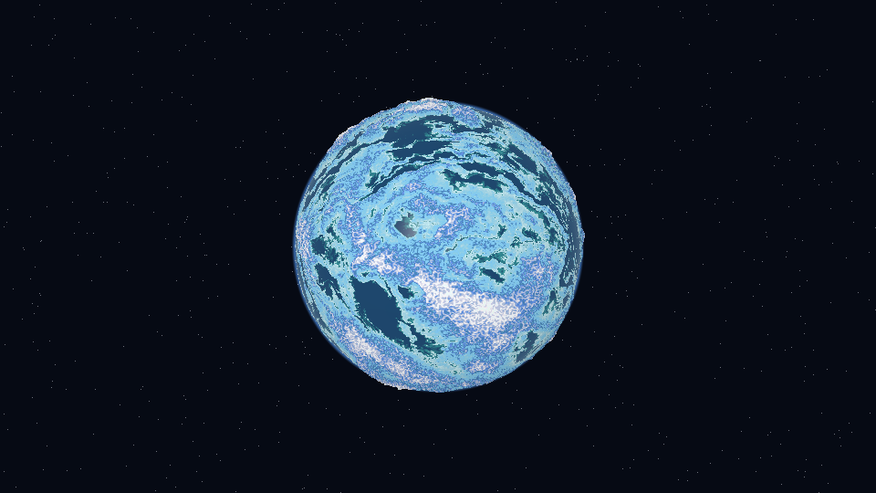
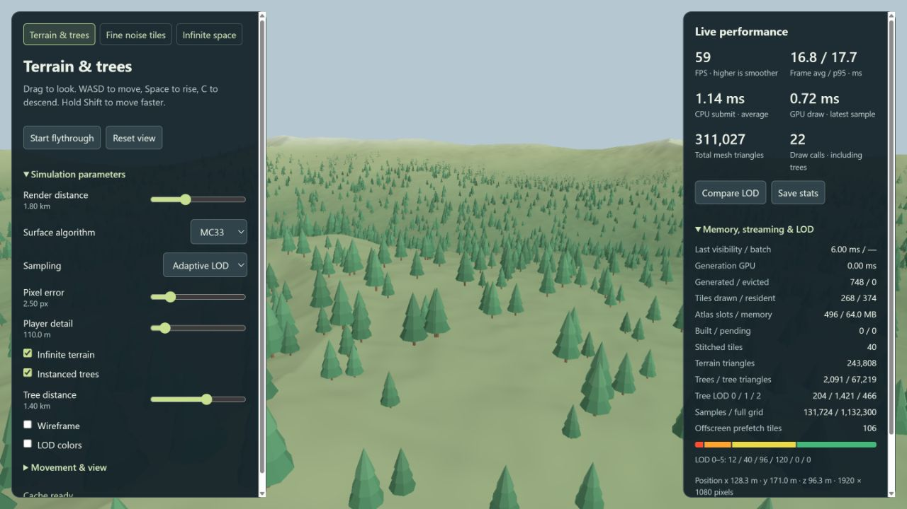

# Marching Cubes — Bourke and MC33

## [Try Me!!](https://marchingcubeswebgpu.netlify.app/)

**Adaptive terrain demo** (`index.html?demo=terrain`) — an 8 × 8 km
GPU terrain map with player/camera-driven sampling, stitched LODs, a resident
cache, an optional infinite flythrough, a render-distance slider, and an
adaptive-vs-uniform benchmark. Space climbs and C descends; terrain has no fog.
Instanced forests have three tree LODs, their own distance slider, and roots
attached to the current stitched terrain triangles. Settled views reuse draw plans.
See [terrain documentation](docs/TERRAIN.md)
and [the HPLOC / older LOD source review](docs/terrain-source-review.md).

Turn a grid of numbers into a 3D shape made of triangles.

Think of a stack of graph paper. Each grid point says whether it is inside or
outside a shape. Marching cubes connects the boundary between the two.
**Bourke** and **MC33** are two ways to make those connections. You can try both.

The terrain and space demos also use **LOD**, short for _level of detail_:
nearby things get more triangles, faraway things get fewer.

## Contents

- [Run it](#1-run-it)
- [Try the demos](#2-try-the-examples): [Sphere](#sphere-turn-points-into-a-surface) · [Terrain](#terrain-detailed-ground-and-trees) · [Space](#space-asteroids-islands-and-planets) · [Noise tiles](#noise-tiles-zoom-from-hills-to-tiny-bumps) · [Planet approach](#planet-approach-from-orbit-to-the-ground)
- [Movement controls](#moving-around)
- [What the sliders and performance numbers mean](#which-sliders-should-i-change)
- [Make a sphere in JavaScript](#3-make-a-sphere-in-javascript)
- [Use it in another project](#4-use-it-in-another-project)
- [Drop-in package API](docs/PACKAGE.md): worlds, cameras, controls and mesh data
- [Deploy to Netlify](#5-put-the-demos-on-netlify)
- [Checks and further reading](#checks-and-further-reading)

## 1. Run it

Install **Node.js 20 or newer**, download or clone this repo, and open a terminal
inside its folder. Run:

```sh
npm install
npm start
```

Open the address printed by the server. Keep that terminal running.
You should see the sphere demo, with **Sphere**, **Terrain**, **Infinite space**, **Noise tiles** and **Planet approach**
buttons at the top. Use those buttons to switch demos.

The sphere works in CPU mode without WebGPU. Terrain, space, noise tiles, planet approach and GPU extraction
need a browser with WebGPU enabled, served locally or over HTTPS.
Use the server above; double-clicking the HTML file will not run the demos correctly.

## 2. Try the examples

### Sphere: turn points into a surface

1. Open **Sphere**. The left panel shows dots; the right shows the triangle surface.
2. Change **Algorithm** between **Bourke isosurfaces** and **Marching Cubes 33**.
3. Change **Surface** to **Outer only**, **Inner only**, or **Both**.
4. Leave **Surface offset** at `0` to keep the outer surface the same size as the dots.
5. Turn on **Wireframe** to see the individual triangles.

**Shell thickness** controls how far inside the outer surface the inner surface
sits. **Compute → WebGPU** runs extraction on the graphics card.
**Coordinates** lets you try a regular box-shaped grid, spherical sampling,
or the six faces of a cube wrapped around a sphere.

This example fits a sphere to sphere-shaped point clouds. It does not reconstruct
arbitrary objects from scattered points.

### Terrain: detailed ground and trees

1. Open **Terrain** and expand **Terrain controls** if they are collapsed.
2. Leave **Sampling** at **Adaptive LOD** and **Instanced trees** enabled.
3. Turn on **LOD colors** or **Wireframe** to see detail change with distance.
4. Enable **Infinite terrain**, then click **Fly through map** to keep generating ground.

To repeat the benchmark pictured below, reload the terrain demo, leave its
defaults in place, and click **Compare LOD**. Wait for the result panel.
It compares adaptive detail against full detail at the same camera position,
with trees enabled. Default terrain distance is `1800 m`; tree distance is `1400 m`.


Recorded here: **184,928 terrain triangles instead of 1,753,088**—89.5% fewer—
with 2,093 trees. Terrain triangle counts exclude trees; render timings include them.
Your counts and timings can differ with window size and hardware.

### Space: asteroids, islands and planets

1. Open **Infinite space** and expand **Space controls** if needed.
2. Keep **Display → Mesh only** for solid surfaces at every distance.
3. Click **Start flythrough**. Drag to look around while you fly.
4. Turn on **LOD colors** to see the ten mesh detail levels. **Farthest mesh LOD** controls the coarsest grade.
5. For a heavier test, raise **Render distance** from `9 km` to `32 km`.

Use **Floating island**, **Ringed planet** or **Asteroid** to jump near an example.
**Island caves** adds intentional openings. The point-cloud display modes show
dots instead of solid triangles, so gaps between dots are expected.


This captured view draws 7,456 bodies with about 1.94 million triangles.
The current 32 km stress test compares five versus ten detail levels:
**10.37 million → 2.01 million triangles** for the same 8,818 bodies.
See [space measurements](docs/SPACE.md#budgets-and-measurements) for the test conditions.

### Noise tiles: zoom from hills to tiny bumps

1. Open **Noise tiles** (`index.html?demo=progressive`).
2. Click **Near the ground**, or drag **Height** down slowly.
3. Watch **finest visible mesh spacing** shrink to **3.125 cm**. These are real bumps in the mesh.
4. Turn on **LOD colors** or **Wireframe** to see the smaller patches appearing.
5. Click **Start flythrough** to generate new ground as you move. Movement slows near the surface.

Think of zooming into a map: generate a smaller, sharper piece where you are
looking, then recycle pieces you have left behind. The GPU keeps a fixed
**6.3 MB tile atlas**, instead of one enormous high-resolution world texture.
Coarse ground stays visible while finer tiles are generated, and tile edges
are stitched together. Lower **Tile detail** to request more detail; memory
stays bounded even when you raise **Render distance**.

See [how progressive tiles work and how to reuse them](docs/PROGRESSIVE.md).


This captured view uses about `4.25 m` height, the default `2 px` detail target
and `8.192 km` render distance: **226,000 triangles, 6.25 cm finest spacing,
6.3 MB atlas**. Click **Near the ground** for the closer, 3.125 cm example.
The atlas stays the same size as you move; counts and timings depend on your
view and hardware.

Turning the camera reuses the generated tiles and only updates visibility.
The GPU check sweeps through a full turn to verify that it triggers **zero new
tile builds**. It also reports CPU time and the peak triangle count, so you can
repeat the performance check on your hardware.

### Planet approach: from orbit to the ground

1. Open **Planet approach** (`index.html?demo=planet`).
2. Choose a **Planet preset** to generate terrain with that palette and landform style, or
   click **Randomize planet** for a new seed and preset.
3. Click **Start approach** to descend from orbit, or **Near surface** to skip ahead.
4. Turn on **LOD colors** or **Wireframe** to see the mesh get finer near the camera.

Raise **Distant LOD** to keep cliffs and ridgelines sharper farther out.
**Patch budget** limits the total number of terrain patches. **Pixel error**
sets how much the renderer can simplify, up to that budget.

Every world, including the first **Lakeshore** view, uses the five-layer
generator from WebGPU Realtime Clouds' Planet Studio. The demo starts with a
fresh seed and shows it in the performance panel. The other 16 palettes come
from Planet Studio. **Gas Giant** applies its original gradient to a solid
surface you can fly down to.

Left drag turns the planet. The closer you are to the surface, the smaller
the turn. Right drag changes the view angle. Movement follows the camera’s
heading as you cross a pole or the longitude seam.

The Studio noise stack lays out the continents and basins, with stronger ridged
multifractal relief on eroded worlds. A coarse pass of the NoiseCompute erosion
filter cuts the mountain faces at roughly twice the scale of the next pass.
Smaller gullies follow the resulting slopes. Regional runoff joins tributaries,
cuts wider valleys, and finds spill paths out of enclosed basins. Local runoff
widens low banks and spreads sediment at the mouths of steep gullies. These
passes run when the planet is generated, with CPU runoff handled by a browser
worker. [Runevision’s erosion filter](https://blog.runevision.com/2026/03/fast-and-gorgeous-erosion-filter.html)

**Lakeshore** and **Ice** have connected alpine
ridges and spurs, **Utahish** and
**Badlands** have stepped cliff bands and mesas, and **Volcanic** and
**Moon Dust** have rough crater rims and basins. These shapes are part of the
terrain mesh. The **Landforms** readout shows which style the planet uses.

Overlapping relief bands from **1.55 km down to 26 m** add spurs, ribs, and
rock faces between the main erosion channels and the fine ground texture.
Nearby mesh patches refine to **2 m spacing**, with shading detail down to
about **0.55 m**. Each world also bakes soft terrain shadows into a **512 ×
512** map. In flight, the shader samples that map to shade valleys and
mountain faces.

About half of seeds get an ocean with depth-dependent color and sky
reflection. The **World surface** readout shows whether the current seed is
wet or dry.









In these 960 × 540 GPU captures with seed `123456789`, orbit drew
**41,440 triangles**, the 7 km overlook drew **329,808**, the low flyover drew
**353,872**, and the ground view drew **359,280** across 13 visible LOD grades.
With a 1,200-patch budget and 3 px error, the same low flyover drew
**236,824** triangles at 0.25× Distant LOD and **553,392** at 4×. Counts vary
with the seed, camera, and view size.







### Moving around

Terrain now prepares nearby ground and tree placements behind you. Space prepares
shared coarse shapes before close-up detail, so bodies have a connected fallback
when you turn. Large turns update visibility immediately; small turns reuse a
slightly wider cached view. The existing memory limits still apply.
See [the turn check results](docs/benchmarks/turn-streaming-webgpu.txt).

Click the terrain, space, noise tiles or planet view before using the keyboard.

| Action                          | Control                        |
| ------------------------------- | ------------------------------ |
| Look around                     | Hold the mouse button and drag |
| Move                            | W / A / S / D                  |
| Go up / down                    | Space / C                      |
| Move faster                     | Hold Shift                     |
| Return to the starting position | Reset                          |

### Which sliders should I change?

| Setting                  | What it does                                                         |
| ------------------------ | -------------------------------------------------------------------- |
| Render distance          | How far away things may be drawn. Lower it for less work.            |
| Terrain: Pixel error     | How much simplification to allow. Higher means less detail.          |
| Terrain: Player detail   | The area around you that keeps high detail.                          |
| Terrain: Tree distance   | How far away trees may be drawn.                                     |
| Space: Detail spacing    | How much simplification to allow. Higher means less detail.          |
| Space: LOD distance      | Lower values switch to simpler meshes sooner.                        |
| Space: Near detail       | The area around you that keeps the finest meshes.                    |
| Noise tiles: Height      | How close you are to the surface; descending requests smaller tiles. |
| Noise tiles: Tile detail | Allowed surface error in pixels; lower values keep smaller bumps.    |
| Planet: Altitude         | Height above the local ground or water.                              |
| Planet: Tile detail      | Lower values refine patches sooner, within the same tile budget.     |

Render distance is a limit, not a promise to fill the entire view. These demos
have memory and object limits. Flat terrain keeps an 8.2 km detail window.
Infinite mode moves that window as you travel and draws coarser terrain beyond
it out to the requested render distance. Distant ground keeps more mesh samples
in the first few outer rings. Shoreline color and lighting sample the same noise
at each pixel, so they stay detailed as the mesh gets coarser. Space fills a 3D region.
The flat terrain keeps a small coarse grid for the entire window, so a full
detail cache no longer shortens the visible horizon.
See the [distance and frame-time checks](docs/benchmarks/terrain-long-range-webgpu.txt).
Noise tiles generate an endless heightfield, with smaller patches near the camera.

**Reading performance:** FPS means frames per second; higher is smoother.
Frame time is milliseconds per frame; lower is better (`20 ms ≈ 50 FPS`).
GPU render time measures only drawing on the graphics card. CPU work, generating
shapes and browser overhead also affect FPS, so a `3 ms` GPU reading does not
mean the whole frame took `3 ms`.

## 3. Make a sphere in JavaScript

After the build, run the included example:

```sh
node examples/sphere.js
```

It prints triangle counts for both algorithms. Here is the complete example:

```js
import { Coordinates, extractCPU } from "../dist/index.esm.js";

const size = { x: 32, y: 32, z: 32 };

// At each grid point: negative = inside the sphere, positive = outside.
const field = Coordinates.sampleField(
  size,
  (x, y, z) => Math.hypot(x - 0.5, y - 0.5, z - 0.5) - 0.3,
);

export function makeSphere(algorithm = "mc33") {
  // Find the surface where the sampled numbers cross zero.
  return extractCPU(field, size, 0, algorithm);
}

for (const algorithm of ["bourke", "mc33"]) {
  const positions = makeSphere(algorithm);
  console.log(`${algorithm}: ${positions.length / 9} triangles`);
}
```

The import path above is for a file in `examples/`. The result is a flat
`Float32Array`: every three numbers are an `x, y, z` point; every three points
make a triangle. That is why triangle count is `positions.length / 9`.
The values in this example occupy a box from `0` to `1` on each axis.

Change `0.3` to change the radius. Increase `32` on all three axes for a finer
grid and more work. Replace the distance formula to make a different shape.
Extraction makes the triangle data; your renderer draws it.

For the same calculation in a browser, keep the server running and open
`examples/browser.html` under the server address. It displays the triangle counts.

## 4. Use it in another project

The package can give you **triangle data** to add to your own engine, or a
**ready-to-draw world** for a canvas. All features are available through ESM,
Node CommonJS and the regular browser script. There are no runtime dependencies.

To build and test the installable package:

```sh
npm run pack:check
```

Install the resulting `marching-cubes-bourke-mc33-1.0.0.tgz` file in your other
project with `npm install <path-to-the-file>`. Then:

```js
import {
  createTerrain,
  TerrainField,
} from "marching-cubes-bourke-mc33/terrain";

const world = await createTerrain(canvas, {
  settings: { infinite: true, trees: { enabled: true } },
});
// Inside your existing animation loop:
world.render({
  position: [0, TerrainField.height(0, 450) + 140, 450],
  target: [0, TerrainField.height(0, 0), 0],
  far: 1800,
});
// When removing the world:
world.dispose();
```

Use `createSpace` or `createProgressiveTerrain` for the other worlds. Use
`createSurface` or `createSphere` for positions/normals you draw yourself.
Optional controls add drag-look, WASD and Space/C movement. Type hints are included.
The [package guide](docs/PACKAGE.md) explains every setting and import, shared GPU
devices, camera integration, cleanup and worker hosting. A complete plain-JS
example lives at **`examples/package.html`**; open it under your server address.



This example uses the package factories directly, with simulation sliders,
movement controls and live FPS, CPU/GPU, triangle, memory and LOD counters.
Its demo links switch between terrain, fine noise tiles and infinite space.
Use **Compare LOD** for adaptive versus full detail, or **Save stats** to download
your current settings and performance readings.

For copying files directly instead of installing a package, build the library:

```sh
npm run build:library
```

Copy the file matching your project from `dist/`:

| Your project                      | File           | How to use it                                                                        |
| --------------------------------- | -------------- | ------------------------------------------------------------------------------------ |
| Browser or Node with ES modules   | `index.esm.js` | `import { extractCPU, Coordinates } from "./dist/index.esm.js";`                     |
| Node with CommonJS                | `index.cjs`    | `const { extractCPU, Coordinates } = require("./dist/index.cjs");`                   |
| Browser with a regular script tag | `index.js`     | Load `<script src="./dist/index.js"></script>`, then use `MarchingCubes.extractCPU`. |

Adjust paths to where you copied the file. Each built library file includes its
shaders and worker code. No Three.js dependency is needed for the library.

To install it as a local package instead, run `npm pack` in this repo. In your
other project, run `npm install` followed by the path to the generated `.tgz` file.
Then import from `"marching-cubes-bourke-mc33"` instead of a file path.

[The API guide](docs/API.md) covers GPU extraction, drawing the result,
spherical coordinates, shader imports and the other exported helpers.

## 5. Put the demos on Netlify

Run:

```sh
npm run build
```

The ready-to-host files are in **`site/`**: one `index.html` and a `dist/` folder.
Upload that folder to a static HTTPS host, or connect the repo to Netlify with:

| Netlify setting   | Value           |
| ----------------- | --------------- |
| Build command     | `npm run build` |
| Publish directory | `site`          |

The included `netlify.toml` already supplies those settings.
The four views use `index.html?demo=sphere`, `index.html?demo=terrain`,
`index.html?demo=space` and `index.html?demo=progressive` on whichever host you use.

## Checks and further reading

`npm test` builds the library and runs the CPU and package checks.

For GPU checks, run `npm run build:checks`, then `npm run serve` if the server
is not already running. Open these paths under its address:

| Page                             | What it checks                                                      |
| -------------------------------- | ------------------------------------------------------------------- |
| `tests/webgpu.html`              | CPU and GPU extraction agree                                        |
| `tests/terrain-webgpu.html`      | Terrain, seams, trees and travel                                    |
| `tests/terrain-range-webgpu.html` | Infinite terrain coverage through 64 km                            |
| `tests/space-webgpu.html`        | Space meshes, points, streaming and both algorithms                 |
| `tests/space-stress-webgpu.html` | The 32 km comparison and moving-camera performance                  |
| `tests/progressive-webgpu.html`  | Fine noise tiles, seamless refinement and bounded memory            |
| `tests/planet-webgpu.html`       | Orbit, oceans, seeded landforms, and 2 m ground patches              |
| `tests/package-webgpu.html`      | Drop-in worlds, controls, external worker and shared-device cleanup |

For source changes, run `npm run build` again and refresh the demo.
Use `npm run build:checks` again after changing GPU check code.

- [API and shader guide](docs/API.md)
- [Drop-in package guide](docs/PACKAGE.md)
- [How terrain works](docs/TERRAIN.md)
- [How space works, including performance measurements](docs/SPACE.md)
- [How progressive noise tiles work](docs/PROGRESSIVE.md)
- [Where the terrain LOD ideas came from](docs/terrain-source-review.md)
- [Credits and third-party notices](THIRD_PARTY_NOTICES.md)

MIT licensed. The [original CodePen](https://codepen.io/mootytootyfrooty/pen/pvJREbv)
shows an older, classic-only version.

See `THIRD_PARTY_NOTICES.md` for source attribution.
