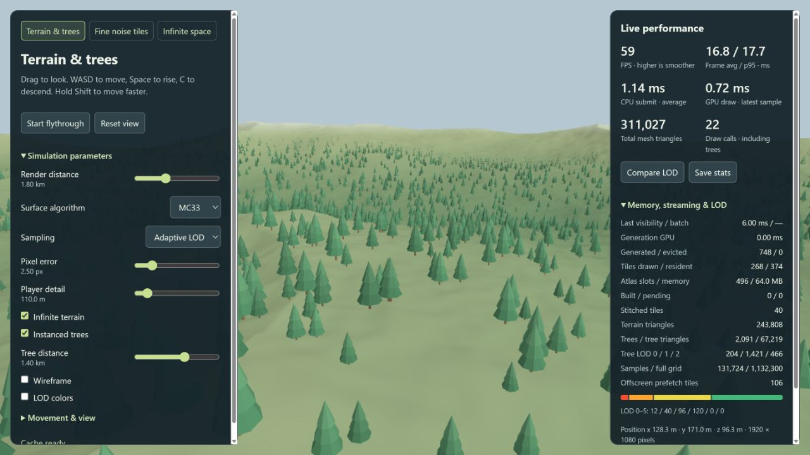

# Use this as a package

[README](../README.md) · [Detailed extraction API](API.md) · [Complete browser example](../examples/package.html)

The package gives you triangle data or a ready-to-draw world. You supply a canvas
and a camera. It does not replace your page, add panels, or start an animation loop.
The JavaScript source is plain ESM. Built files include their shaders and default
space worker, so the receiving project needs no WGSL loader or tinybuild setup.
There are **no runtime dependencies**. Three.js is optional.

## Contents

- [Install](#install)
- [Choose an import](#choose-an-import)
- [Add a world](#add-a-world)
- [Change settings](#change-settings)
- [Use your camera](#use-your-camera)
- [Optional movement controls](#optional-movement-controls)
- [Get mesh data](#get-mesh-data)
- [Fit a sphere or shell](#fit-a-sphere-or-shell)
- [Devices and cleanup](#devices-and-cleanup)
- [Space workers](#space-workers)
- [Allocation options](#allocation-options)
- [Turning and streaming](#turning-and-streaming)
- [Check the package](#check-the-package)

## Install

In this repository:

```sh
npm install
npm run pack:check
```

That builds and tests `marching-cubes-bourke-mc33-1.0.0.tgz`. In another project,
install the file using its location on your computer:

```sh
npm install ../MarchingCubes_BourkeIsoSurfaces/marching-cubes-bourke-mc33-1.0.0.tgz
```

This works before publishing to npm. The example assumes the two projects are
neighboring folders; adjust the path if necessary. Nothing is published by these commands.

## Choose an import

| Import                                   | Includes                                                                  |
| ---------------------------------------- | ------------------------------------------------------------------------- |
| `marching-cubes-bourke-mc33`             | Everything below                                                          |
| `marching-cubes-bourke-mc33/core`        | Bourke/MC33 extraction, coordinates, fields, meshes and sphere shells     |
| `marching-cubes-bourke-mc33/terrain`     | Terrain, stitched LOD, PLOC and instanced trees                           |
| `marching-cubes-bourke-mc33/space`       | Infinite space, eight mesh LODs, point clouds, geometry and world helpers |
| `marching-cubes-bourke-mc33/progressive` | Fine noise tiles, bounded cache, field and tile planner                   |
| `marching-cubes-bourke-mc33/camera`      | Camera math, Three.js adapter and optional fly controls                   |

```js
import { createTerrain } from "marching-cubes-bourke-mc33/terrain";
// Node CommonJS works too:
// const { createSphere } = require("marching-cubes-bourke-mc33/core");
```

For a browser without a bundler, copy `dist/` beside your page and import
`./dist/terrain.esm.js`, or load `<script src="./dist/index.js"></script>` and
use `MarchingCubes.createTerrain(...)`. ESM and CommonJS entries include type hints.
CPU extraction and data helpers work in Node without a DOM. Drawing a world
requires a browser WebGPU canvas; CPU extraction remains available without WebGPU.

## Add a world

Give the canvas a visible CSS size, then initialize once and render each frame:

```html
<canvas id="world" style="width:100%;height:600px"></canvas>
<script type="module">
  import { createTerrain, TerrainField } from "./dist/terrain.esm.js";

  const canvas = document.getElementById("world");
  const world = await createTerrain(canvas, {
    settings: { infinite: true, trees: { enabled: true, distance: 1400 } },
  });
  const camera = {
    position: [0, TerrainField.height(0, 450) + 140, 450],
    target: [0, TerrainField.height(0, 0), 0],
    fov: Math.PI / 3,
    near: 0.1,
    far: 1800,
  };
  let frame;
  function animate(now) {
    world.render(camera, { now });
    frame = requestAnimationFrame(animate);
  }
  frame = requestAnimationFrame(animate);
  window.addEventListener(
    "pagehide",
    () => {
      cancelAnimationFrame(frame);
      world.dispose();
    },
    { once: true },
  );
</script>
```

Use `createSpace` or `createProgressiveTerrain` the same way. The
[complete example](../examples/package.html) switches between all three and adds
simulation sliders, movement controls and live performance counters. Serve it using `npm start`, then open `examples/package.html` under the
server address. `view.stats` exposes counters; `view.errors` contains GPU/worker errors.
`view.renderer` gives access to the existing low-level API, including readback.

The example's **Simulation parameters** panel exposes each world's settings,
including render distance, detail, tree LOD controls and space display modes.
**Movement & view** adds speed, field of view and height. **Live performance**
shows frame average/p95, CPU submission, sampled GPU time, triangles (including
trees), draw calls, cache memory, loading work and the drawn LOD distribution.

For terrain or space, **Compare LOD** freezes the camera, warms both modes and
samples 40 frames each before restoring your settings. Keep the tab selected
for timing. **Save stats** downloads settings, camera, resolution and readings
as JSON. Memory/view budgets still apply to full detail. GPU timestamps appear
as `—` when unavailable; background tabs are labelled instead of reporting them
as foreground performance. Copy both `examples/package.html` and
`examples/package.js` when reusing this control panel.

## Change settings

Call `view.configure(...)` whenever a control changes. Constructor options
allocate resources; these settings change behavior without recreating the world.
Unknown or invalid settings throw an error instead of silently doing nothing.

| World             | Runtime settings                                                                                            |
| ----------------- | ----------------------------------------------------------------------------------------------------------- |
| All               | `renderDistance` (metres), `lodColors`                                                                      |
| Terrain           | `algorithm`, `pixelError`, `nearRadius`, `uniform`, `infinite`, `wireframe`, `trees: { enabled, distance }` |
| Space             | `algorithm`, `mode`, `quality`, `uniform`, `pointSize`, `lodDistance`, `nearRadius`, `caves`                |
| Progressive tiles | `pixelError`, `wireframe`, `tileBorders`                                                                    |

```js
terrain.configure({
  algorithm: "mc33",
  pixelError: 3,
  trees: { distance: 2000 },
});
space.configure({
  mode: "mesh",
  lodDistance: 2500,
  nearRadius: 150,
  caves: false,
});
tiles.configure({ pixelError: 2, renderDistance: 4096, tileBorders: true });
```

Algorithms are `"bourke"` or `"mc33"`; space modes are `"mesh"`, `"points"` and
`"hybrid"`. Mesh is the default. Progressive tiles use their stitched heightfield
specialization. Defaults for the other settings match the original renderers;
see [terrain](TERRAIN.md), [space](SPACE.md) and [fine tiles](PROGRESSIVE.md).

`renderDistance` overrides the camera far plane, including its projection and
culling. Omit the setting to use the camera's `far`. `configure` merges partial
tree settings. `view.settings` returns a copy; change values with `configure`.

## Use your camera

The easiest camera is the plain object above. Change its `position` and `target`
or `forward` before drawing. Positions and distances are in world units; the demo
fields use metres. **FOV is vertical, in radians**. Aspect and pixel height default
to the current canvas dimensions. The wrapper handles camera-relative space
rendering and frustum culling for you.

If you already use Three.js, pass its **PerspectiveCamera** directly:

```js
threeCamera.updateProjectionMatrix(); // after changing FOV, aspect or zoom
world.render(threeCamera);
```

The adapter supports an OpenGL-depth perspective projection, including zoom and
view offsets, without importing Three.js. It reads the camera's world transform.
The raw renderers still accept their original camera formats.

For another engine, import `createCamera` to build a camera snapshot, or supply a
column-major **OpenGL-depth** `viewProjection` matrix with `position`, `fov`,
`near`, `far` and optional `height`/`player`. Space matrix inputs also require
`right`, `up`, `forward` and `tanX` for the star background. These are world-space
cameras; the wrapper converts them for space internally. The shaders convert
OpenGL depth to WebGPU depth when drawing.

`view.render(camera, { now, planes })` accepts optional world-space frustum planes
`[nx, ny, nz, constant]`, with the interior nonnegative. Use `planes: []` to
disable frustum culling. `now` is milliseconds, normally the animation timestamp.
Terrain can refine around a separate player by passing `player: [x,y,z]`.

Each world renderer manages its own canvas context and clears it each frame. To
put extracted meshes into an existing engine scene or shared render pass, use
the mesh data API below. A supplied GPU device can be shared across canvases.

## Optional movement controls

```js
import { attachFlyControls } from "marching-cubes-bourke-mc33/camera";
import { TerrainField } from "marching-cubes-bourke-mc33/terrain";

const camera = { position: [0, TerrainField.height(0, 0) + 80, 0], far: 1800 };
const controls = attachFlyControls(canvas, camera, {
  speed: 50,
  groundHeight: TerrainField.height,
  clearance: 80,
});
// In your loop:
controls.update(deltaSeconds);
world.render(camera);
// Optional automatic travel:
controls.fly = true;
// When removing the world:
controls.dispose();
world.dispose();
```

Click/drag the canvas to focus and look. WASD moves, Space rises, C descends and
Shift speeds up. Keyboard controls act only while that canvas is focused.
For space, omit `groundHeight`. `controls.enabled` pauses input;
`controls.followGround`, `controls.clearance` and `controls.speed` are adjustable.
Disposal removes listeners and restores the canvas styles/tab focus added by
the helper. Your app owns the animation loop.

## Get mesh data

```js
import { createSurface } from "marching-cubes-bourke-mc33/core";

const mesh = await createSurface({
  size: { x: 48, y: 48, z: 48 },
  sample: (x, y, z) => Math.hypot(x - 0.5, y - 0.5, z - 0.5) - 0.3,
  algorithm: "mc33",
});
// mesh.positions: Float32Array of xyz triangles
// mesh.normals: Float32Array of matching flat normals
// mesh.triangleCount; mesh.bounds.min/max
```

Pass exactly one of `sample` or `field`. `field` is a `Float32Array`; `size`
describes its structured grid, with X varying fastest. Defaults are 33³ samples,
isolevel `0`, MC33 and CPU. `isoLevel` changes the boundary. `coordinates` accepts
the same Cartesian, spherical or cube-sphere configuration as the low-level API.
Set `normals: false` to skip flat normal generation (returns `null`). Collapsed
triangles at exact isosurface corners have zero normals. Empty meshes have zero bounds.

For GPU extraction, add `backend: "gpu"` and optionally `device`. The result is
read back to CPU arrays. Without a device, this helper creates and cleans up its
own; for repeated GPU extraction, supply a reusable device. The synchronous
`extractCPU` and original `extractGPU` remain exported for finer control.

## Fit a sphere or shell

```js
import { createSphere } from "marching-cubes-bourke-mc33/core";

const mesh = await createSphere({
  points: xyzPointCloud, // or center: [0,0,0], radius: 100
  surface: "both", // "outer", "inner", or "both"
  thickness: 2,
  offset: 0,
  coordinates: "cube-sphere", // also "cartesian" or "spherical"
  algorithm: "mc33",
});
```

This fits **sphere-shaped** clouds; it is not general scattered-point reconstruction.
With `offset: 0`, the outer radius matches the fitted points. Thickness and offset
use the points' world units, independent of scale or location. Defaults without
points are center `[0,0,0]`, radius `1`, outer surface and thickness `radius * 0.02`.
`size`, `backend` and `device` work as above. Cube-sphere generates all six faces.

The result includes radial normals, fitted `center`/`radius` in `mesh.fit`, and
`mesh.groups`: `{ side, radius, start, count }`. Start/count are **vertices**,
suitable for Three.js `BufferGeometry.addGroup`; inner normals point inward.
Use positions/normals directly in your engine's vertex buffers.

## Devices and cleanup

All three factories accept `{ device, format, pixelRatio }`. Without a device,
they request one and own it. `dispose()` destroys owned resources and devices;
it is safe to call twice. A device you supplied stays alive. Initialization
failure cleans up resources already allocated. Keep one owner for each canvas.

```js
import { createGPUDevice, disposeGPU } from "marching-cubes-bourke-mc33/core";
const device = await createGPUDevice(); // requests timestamps when supported
const view = await createTerrain(canvas, { device });
// ...
view.dispose();
await disposeGPU(device); // release extraction caches if you used extractGPU
device.destroy(); // caller-owned device: caller performs this step
```

`createGPUDevice` also accepts `adapterOptions`, `requiredFeatures`,
`requiredLimits` and `timestamps: false`. `isWebGPUSupported()` checks availability
without requesting a device. No renderers initialize at module import time.
Canvas resize is handled on the next render. OffscreenCanvas uses its explicit
pixel width/height; optional pointer controls require a regular browser canvas.

## Space workers

Default space workers are embedded in the built package. You do not need a worker
loader in your app. Set `workers: 1` through `8` at creation (default `2`).
Hosts using this default must allow `blob:` in their `worker-src` policy.

For a host that uses external workers instead, copy `dist/space.worker.js` to a
served asset path and set `workerURL`:

```js
const space = await createSpace(canvas, {
  workers: 2,
  workerURL: new URL("./assets/space.worker.js", location.href),
});
```

The worker file is self-contained; serve it from the same origin. Its package
export is `marching-cubes-bourke-mc33/space.worker` for resolving/copying during
your build. Source imports under `/src/` require WGSL text loading and the
tinybuild worker plugin; [source build settings](API.md#wgsl-and-worker-imports)
explain that advanced path.

## Turning and streaming

Terrain prepares nearby patches in every direction, including behind the camera.
Trees warm two offscreen placements per frame. Space workers prepare all twelve
connected coarse shapes first, then medium detail when higher-priority work is done.
The same small shapes are reused by thousands of bodies.

Both worlds keep a narrow overlap outside the CPU view. The GPU clips it to the
actual camera, and large turns refresh visibility immediately. A resident coarse
mesh stays visible while finer geometry loads. Old queued space detail is dropped
when it is no longer useful. These changes apply to the factories and the demos;
no extra setup or larger cache budget is required.

Newly visited ground can still load progressively, and mesh detail can change
as LODs arrive. Maximum render distance remains subject to the memory and instance
limits. See [repeatable turn checks](../tests/turn-webgpu.html) and the
[recorded run](benchmarks/turn-streaming-webgpu.txt).

## Allocation options

These are set at creation; recreate the world to change them.

| Factory                    | Options and defaults                                                                                             |
| -------------------------- | ---------------------------------------------------------------------------------------------------------------- |
| `createTerrain`            | `worldSize:8192`, `tileSize:128`, `maxDivs:64`, `memoryMB:64`, `buildsPerFrame:8`                                |
| `createSpace`              | `maxInstances:12000`, `maxChunks:2048`, `geometryMB:64`, `pointBudget:600000`, `workers:2`, optional `workerURL` |
| `createProgressiveTerrain` | `rootSize:1024`, `minSize:1`, `divs:32`, `memoryMB:8`, `maxTiles:384`, `buildsPerFrame:6`                        |
| All                        | Optional `device`, `format`, `pixelRatio`; default pixel ratio is device ratio capped at 1.5                     |

Sizes/divisions for terrain and progressive tiles are powers of two. Terrain
accepts 4–128 divisions and up to 512 tiles per map side. Progressive accepts
2–128 divisions, at least 4 MiB allocation budget and 48–1,024 tile slots.
Actual cache sizes respect GPU limits and packing. Memory options bound the
corresponding sample/geometry cache; frame buffers and other resources add memory.

Low-level namespaces remain exported for custom integration: coordinate mapping,
field sampling, Bourke/MC33 polygonizers and shaders, PLOC, stitching, tree geometry,
space generation, point clouds, and the progressive tile planner. Their original
interfaces are retained; [API](API.md#other-exports) lists these exports.

## Check the package



`npm test` checks geometry, shells, cameras, lifecycle/settings and all original
algorithms. `npm run pack:check` installs the actual tarball into an isolated
consumer, then checks every ESM/CommonJS entry, the browser global and worker asset.
It needs no registry access or runtime dependencies for that consumer.

After `npm run build:checks`, open `tests/package-webgpu.html` under your server
address. It draws all three world types, uses an external space worker, switches
settings, checks controls, and verifies that disposal preserves a shared device.
The other GPU pages cover each renderer in greater detail.
`tests/turn-webgpu.html` checks a 180° terrain turn and a full space heading sweep
while detail is loading. `tests/space-stress-webgpu.html` verifies the 32 km view.

Type hints are handwritten `.d.ts` files for the public convenience API and
renderers; low-level planner/geometry namespaces retain flexible types. A
TypeScript installation can check the consumer example with
`tsc -p tests/tsconfig.types.json`. TypeScript is not needed to build or run this package.
