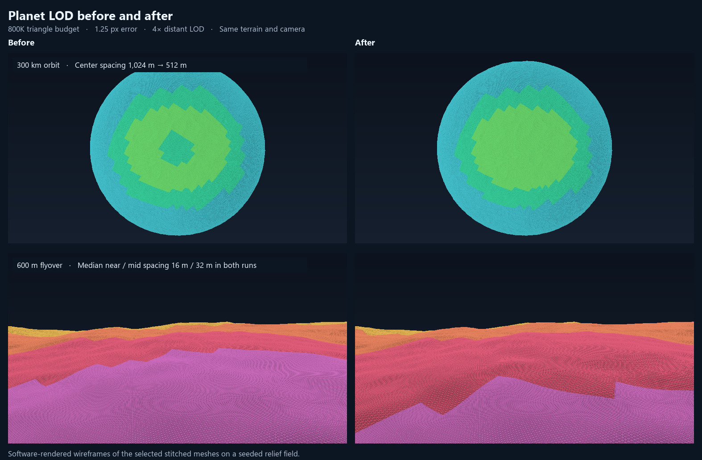
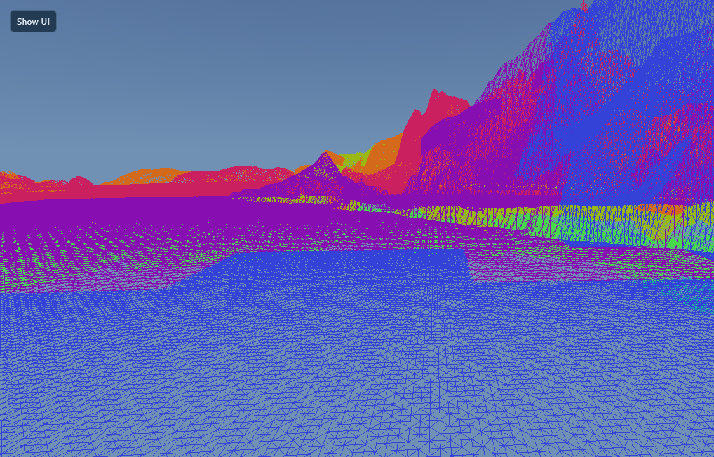
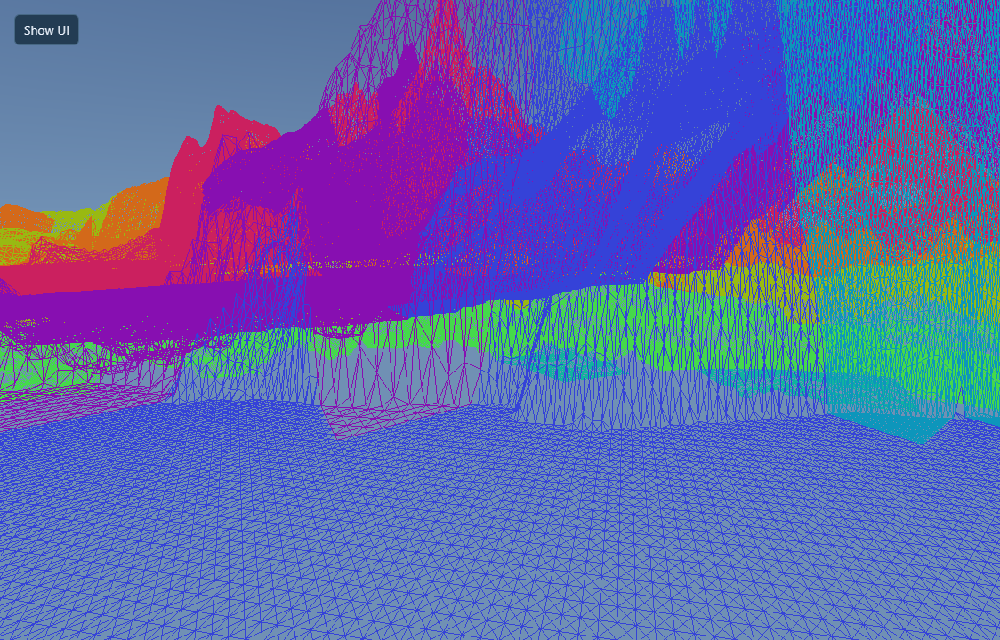
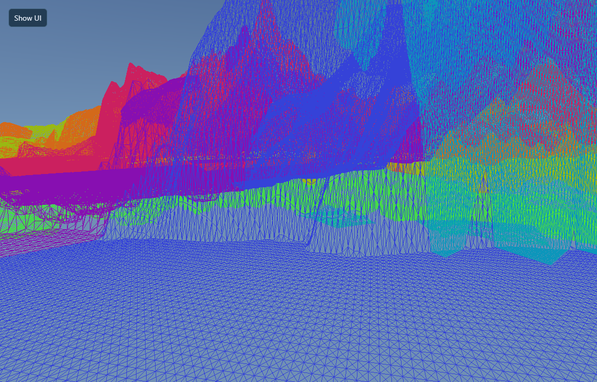

# Planet LOD comparison

Both runs used the same seeded test relief, camera path, 1.25 px error, and 4× distant LOD. The four-second flyover covered 1.2 km at 600 m clearance and turned 22° to either side of the direction of travel. The view looked across the terrain toward the horizon. Each run started with a stationary warmup.

| Triangle budget | Patch rebuilds | Median submitted terrain triangles | Median near / mid grid spacing | 95th-percentile planning time |
| --- | ---: | ---: | ---: | ---: |
| 250,000 | 153 → 127 | 160,232 → 147,856 | 64 / 64 m → 32 / 64 m | 2.14 → 1.29 ms |
| 800,000 | 839 → 774 | 641,840 → 630,696 | 16 / 32 m → 16 / 32 m | 5.33 → 4.27 ms |
| 2,000,000 | 3,520 → 3,126 | 1,779,072 → 1,743,264 | 8 / 16 m → 8 / 16 m | 14.24 → 12.91 ms |

Near and mid spacing are measured 350–1,250 m and 1.5–6.5 km out along the surface, respectively. At the 800,000-triangle budget, draw layout changes fell from 40 to 35 during the flight. From 300 km up, the mesh directly under the camera went from 1,024 m to 512 m spacing at the same settings.

The wireframes above are software renders of the selected stitched meshes. Patch rebuilds count cache misses. Timings in the table cover the CPU LOD planner.

## WebGPU flyover

| Before | After |
| --- | --- |
|  |  |

Both runs used the Lakeshore preset, seed `2752142637`, procedural vertices, and the 800,000-triangle budget. The camera flew at 600 m clearance for four seconds with turns up to 39° from its heading. Cloud rendering was paused to measure terrain by itself.

| Measurement | Before | After |
| --- | ---: | ---: |
| Terrain patches rebuilt | 1,129 | 973 |
| Largest patch generation batch | 97 | 87 |
| Median submitted triangles | 681,752 | 618,736 |
| Median finest grid spacing | 32 m | 32 m |
| 95th-percentile CPU render time | 2.6 ms | 2.3 ms |
| Median GPU draw time | 5.61 ms | 5.68 ms |
| 95th-percentile frame interval | 16.8 ms | 16.8 ms |

The tighter frustum bound keeps a margin for camera turns between selections. GPU draw time covers the render pass. These timings are from one local run per build.

### Reusing finer patch samples

A ten-second run reused about 98,000 vertex samples from cached child patches when coarser patches returned. That avoided evaluating three procedural heights per reused vertex. The sample cache stayed at 1,626 slots.

The performance panel shows GPU draw time and the latest timed patch build batch. The batch readout includes its patch count.

| Ten-second flyover | Child reuse disabled | Child reuse enabled |
| --- | ---: | ---: |
| GPU patch generation per 100 sampled patches | 1.81 ms | 1.58 ms |
| 95th-percentile sampled GPU batch time | 1.21 ms | 1.12 ms |
| Median finest grid spacing | 16 m | 16 m |
| 95th-percentile frame interval | 16.8 ms | 16.8 ms |

Both runs used the same build, seed, camera path, and 800,000-triangle budget. The comparison disabled child reuse in the patch jobs for one run. GPU time per 100 patches divides total sampled GPU build time by the number of patches in those batches. Each run timed 73 batches.

### Smoother refinement during turns

| Before | After |
| --- | --- |
|  |  |

Patch priority now fades at the edge of the view. The distance pass gives nearby terrain a small priority boost when the triangle budget is tight.

| 600 m flyover, 800,000-triangle budget | Before | After |
| --- | ---: | ---: |
| Terrain patches rebuilt | 2,763 | 1,905 |
| Largest patch generation batch | 93 | 78 |
| Median submitted triangles | 621,224 | 595,008 |
| Median near / mid grid spacing | 32 / 32 m | 32 / 32 m |
| Median finest grid spacing | 16 m | 16 m |
| 95th-percentile CPU render time | 3.9 ms | 3.0 ms |
| 95th-percentile sampled GPU patch batch time | 0.96 ms | 0.77 ms |
| 95th-percentile frame interval | 16.8 ms | 16.8 ms |

The comparison uses one ten-second WebGPU run per build at 1124 × 720, with matched seed, camera path, and cache capacity. The camera moved at 300 m/s and turned up to 39° to either side. Near and mid spacing use the distance bands above. At 250,000 and 2,000,000 triangles, a planner replay over synthetic relief showed fewer rebuilds and the same median near and mid spacing.
